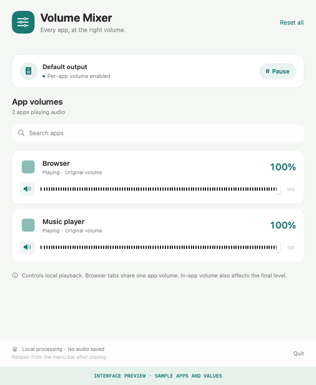

# Volume Mixer for macOS


**Turn down one app. Keep the rest of your mix.**

Volume Mixer is a free, open-source Mac app with independent playback volume and mute controls. Lower a browser, balance background music, or silence one app while the others keep playing. Built with SwiftUI, AppKit, and Core Audio; audio stays on your Mac.

[](https://github.com/HermanLL66/mac-volume-mixer/releases/download/v0.1.0/Volume-Mixer-0.1.0-macOS-arm64.zip)

**macOS 14.4+ · Apple Silicon · MIT license · Early release**

The download is ad hoc signed and not notarized by Apple. Read the [first-launch guide](docs/GETTING_STARTED.md) before trying it.

[Release notes](https://github.com/HermanLL66/mac-volume-mixer/releases/latest) · [Quick start](docs/GETTING_STARTED.md) · [Tested configurations](docs/COMPATIBILITY.md) · [Build from source](#build-from-source) · [Report an audio issue](https://github.com/HermanLL66/mac-volume-mixer/issues/new?template=audio_bug.yml)

## See the controls



*Interface preview rendered from the actual SwiftUI view with sample apps and values. This is not a live audio recording or a third-party app compatibility test. The [separate audio checks](docs/VERIFICATION.md) document measured behavior.*

## Features

- **Per-app volume:** independent sliders from 0% to 100%.
- **Individual mute:** silence one app without muting the rest.
- **Automatic discovery:** find apps that are playing audio and group their helper processes where possible.
- **Saved settings:** restore each app's volume and mute preferences when it appears again.
- **Quick search:** find the app you want to adjust.
- **Menu bar access:** close the window and reopen it from the menu bar.
- **Pause and reset:** release processing while keeping preferences, or restore all apps to 100%.
- **Local audio processing:** no audio recording, uploads, accounts, or network service.

The app works with discovered audio sources rather than a preset list of messaging, browser, or music apps. Compatibility depends on each app's audio path and the connected output device.

## Requirements

| Requirement | Support |
| --- | --- |
| Operating system | macOS 14.4 or later |
| Downloadable build | Apple Silicon (`arm64`) |
| Output | System default mono or stereo speakers/headphones |
| Permission | System audio access, granted through macOS |

The source build targets the current machine's architecture. Intel builds are not included in the initial download and have not been validated.

## Install


1. Download the Apple Silicon ZIP from [Releases](https://github.com/HermanLL66/mac-volume-mixer/releases/latest).
2. Extract it and move **Volume Mixer.app** to your Applications folder.
3. Open Volume Mixer, then follow the audio permission steps below.

The initial release is an **ad hoc signed, unnotarized build**. It is not signed with an Apple Developer ID, and macOS may prevent a downloaded copy from opening. Follow the [first-launch guide](docs/GETTING_STARTED.md) or build locally from source. Signature verification and checksums do not replace Apple notarization.

## Use

1. Start audio playback in the apps you want to control.
2. Click **Enable** in Volume Mixer. Allow system audio access when macOS asks. Initial verification plays a very quiet generated tone.
3. Drag an app's slider or click its speaker button to mute or unmute it. Preferences are saved automatically.
4. Click **Pause** to restore original playback while retaining preferences, or **Reset all** to restore every saved setting to 100% and unmute it.
5. Close the window to keep the app available in the menu bar. Use **Quit** to release the app's audio resources.

If audio verification fails, check **System Settings > Privacy & Security > Screen & System Audio Recording**. Some macOS versions label this **Screen Recording**. Allow Volume Mixer, then retry. Quit and reopen it if macOS requests that step.

## What it controls

Volume Mixer changes the audio you hear on this Mac. It does not change microphone gain sent to another call participant. Browser tabs share their browser's app volume; this is not a per-tab mixer.

At 100%, the app releases its processing channel and returns to the original playback path. It follows the default output device without replacing it or changing hardware master volume.

Protected media, exclusive devices, unusual audio formats, and some special-purpose processes may be unsupported. App names are supplied by macOS and can follow the system's language. Digital gain percentages are not measurements of perceived loudness.

## Build from source

Install Apple's Command Line Tools with Swift and an SDK containing the Core Audio tap APIs, then run:

```sh
git clone https://github.com/HermanLL66/mac-volume-mixer.git
cd mac-volume-mixer
./build.sh
open "dist/Volume Mixer.app"
```

The build script compiles the app and helper for the current CPU architecture, applies a local ad hoc signature, and verifies the bundle. Output is written to `dist/Volume Mixer.app` and `dist/Volume Mixer.zip`. No third-party runtime packages are required.

For a repeatable build, use a local folder outside cloud-synced Desktop or Documents locations. Sync providers can attach Finder metadata that interferes with bundle signature verification.

## Development and verification

```sh
./test.sh
mkdir -p output
"./dist/Volume Mixer.app/Contents/MacOS/VolumeMixer" --verify-worker "$PWD/output/worker-verification.json"
python3 -m json.tool output/worker-verification.json
```

The fast checks cover DSP behavior and mock-worker lifecycle failures without intercepting real application audio. The [testing guide](docs/TESTING.md) contains the optional real-audio checks and explains their evidence limits. Inspect the JSON `passed` field instead of relying only on the app's exit code.

See [verification status](docs/VERIFICATION.md) for checks performed on this release and [architecture](docs/ARCHITECTURE.md) for the implementation map.

## Help test your apps and devices

The standalone build has passed generated-signal and independent digital-output checks on macOS 14.6.1 with Apple Silicon and built-in stereo speakers. Broader third-party app and device coverage still needs testing; see the [compatibility table](docs/COMPATIBILITY.md).

If you try it, a [working configuration or reproducible audio report](https://github.com/HermanLL66/mac-volume-mixer/issues/new?template=audio_bug.yml) helps other Mac users know what to expect. Include your app version, macOS version, output device, and result. No audio recording is needed.

## Feedback and license

When reporting a problem, include your macOS version, CPU architecture, output device, affected app, reproduction steps, and expected/actual behavior. Remove personal information from logs before sharing them.

Released under the [MIT License](LICENSE).

If you find Volume Mixer useful, consider giving the repository a star. It helps other Mac users discover it.
