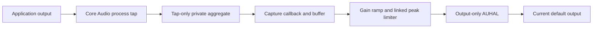

# Architecture of the experimental 0.2.0 source

This document describes the current source candidate. The downloadable 0.1.0 release uses the earlier audio path; its successful checks are historical evidence, not validation of this revision.

Volume Mixer is a native macOS application. The interface and audio integration run in separate processes so an unresponsive audio operation can be bounded without freezing the controls.

| Component | Responsibility |
| --- | --- |
| `Sources/main.swift` | App lifecycle, window, menu bar entry, diagnostic entry points |
| `Sources/MixerView.swift` | Continuous sliders, mute, filters, search, connection and error states |
| `Sources/MixerModel.swift` | Preferences, visible state, coalesced setting updates |
| `Sources/AudioWorker.swift` | Worker client/server, JSON pipes, deadlines, cancellation, process termination |
| `Sources/CoreAudioSupport.swift` | Core Audio helpers and audio-source discovery |
| `Sources/AudioEngine.swift` | Session reconciliation, device changes, signal verification, health, retries, and slider mapping |
| `Sources/TapSession.swift` | Process taps, tap-only private aggregates, output-only AUHAL, callback ownership and cleanup |
| `Sources/AudioDSP.c` | Sample gain, ramping, linked limiting, validation, and atomic controls |
| `Sources/AudioTransport.c` | Preallocated SPSC FIFO, capture/render clock bridging, linear resampling and bounded drift correction |
| `Sources/*Verification.swift`, `Tests/` | Checks at distinct integration levels |

The UI's `AudioEngine` client is declared in `AudioWorker.swift`; the audio-owning `LocalAudioEngine` is declared in `AudioEngine.swift`.

## Audio path

The aggregate contains the tap rather than a physical microphone or combined input/output device. Rendering uses a separate AUHAL with physical input I/O disabled. The mixer does not capture a microphone or set its gain. The default output device and hardware master volume are not replaced by the mixer.

Capture and rendering run independently. The buffer target adds approximately 20 ms, plus hardware and scheduling latency; it is not a promise of a measured end-to-end delay on every device.

The transport uses linear interpolation with bounded drift correction. It is not a high-quality converter for large sample-rate changes. Startup/idle underflow is recorded separately from invalid buffers and callback stalls.

## What a percentage means

The saved percentage is an amplitude setting: 0% is silence, 100% is unity, and 200% requests a gain of 2 before limiting. The slider changes the mapping between travel and gain without changing these labels. Unity sits at 75% of the track, leaving the final quarter for boost. Changes use a 30 ms gain ramp.

A linked peak limiter applies the same reduction to both stereo channels. It limits boosted peaks rather than promising a fixed loudness increase. Source headroom, the limiter, hardware volume, and hearing all affect the result; 200% is not a guarantee of twice the perceived loudness.

## Ownership and recovery

Before taking over a signal, the processing channel must receive valid, nonzero audio. Permission verification uses a quiet generated signal. At 100%, or when control is paused, the app requests release of the processing path so native playback can continue.

The worker retains ownership information for resources that could not be released and reports cleanup errors. The client imposes deadlines and can stop its own worker after an unanswered operation. It does not automatically restart system audio services.

Audio is processed in local memory. There is no audio file recording or upload path.

## Evidence limits

Read-only hardware input state checks can show that selected input properties did not change. They cannot show what a conferencing app's acoustic echo cancellation or automatic gain control does, nor what another participant hears. The shared backend has local development-bundle checks recorded in the verification page; the English bundle needs its own real-audio run. Real calls, Bluetooth, and broad device compatibility are unvalidated.

## Platform reference

[Apple: Capturing system audio with Core Audio taps](https://developer.apple.com/documentation/coreaudio/capturing-system-audio-with-core-audio-taps).
