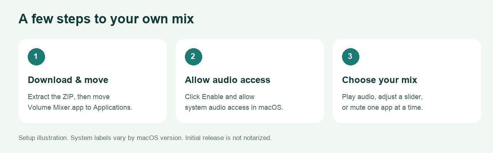

# Get started with Volume Mixer

The graphic is an illustrated setup guide. It is not a screenshot of System Settings; permission labels vary by macOS version.

## Version choice

The download is **0.2.0, an experimental pre-release**, with the new design and 0–200% controls. Packaging and fast checks passed locally, but real-audio validation under this English bundle identity remains pending. Shared-backend development measurements are recorded separately. The historical 0.1.0 release has the earlier interface and 0–100% range. The setup graphic above belongs to that earlier edition.

## 1. Download and install

Download [Volume Mixer v0.2.0 for Apple Silicon](https://github.com/HermanLL66/mac-volume-mixer/releases/download/v0.2.0/Volume-Mixer-0.2.0-macOS-arm64.zip). It requires macOS 14.4 or later. This version is marked as a pre-release; use the explicit 0.2.0 link rather than GitHub’s latest stable release link.

Extract the ZIP in Finder and move **Volume Mixer.app** to Applications. The release includes [SHA256SUMS.txt](https://github.com/HermanLL66/mac-volume-mixer/releases/download/v0.2.0/SHA256SUMS.txt) for checking the download.

The current binary is ad hoc signed and **not notarized by Apple**. If macOS prevents it from opening, review [Apple's guidance on safely opening apps](https://support.apple.com/en-us/102445) and make your own trust decision. [Building from source](../README.md#build-from-source) is also available. A checksum or passing build does not replace notarization.

## 2. Enable audio access

Open Volume Mixer and click **Enable**. macOS may ask for audio access. Initial verification plays a very quiet generated tone.

If the app reports that it cannot receive audio:

1. Open **System Settings**.
2. Choose **Privacy & Security**.
3. Open **Screen & System Audio Recording**, or **Screen Recording** on some versions.
4. Locate **Volume Mixer** and allow its system audio access.
5. Return to the app and retry. Quit and reopen it if macOS requests that step.

See [Apple's audio-permission documentation](https://support.apple.com/guide/mac-help/control-access-screen-system-audio-recording-mchld6aa7d23/mac) for the current system controls. The app processes audio in memory; it does not record audio files or upload audio.

## 3. Make your first mix

Start playback in an app so Volume Mixer can discover it. Set that app's slider to a lower value and use the speaker button to mute or unmute it. Settings are saved automatically.

Browser tabs share one browser volume. The controls target local playback. The 0.2.0 backend does not capture a microphone or set microphone gain, but unchanged far-end call audio and conferencing echo cancellation have not been established. Test an actual call before relying on that configuration.

In the 0.2.0 pre-release, 100% is the original amplitude and sits at 75% slider travel. Up to 200% requests 2× amplitude before peak limiting; this does not guarantee twice the perceived loudness. Capture/render buffering adds a target of approximately 20 ms plus other device latency. The historical 0.1.0 download retains its original 0–100% behavior.

**Pause** releases audio processing and retains preferences. **Reset all** restores all saved volumes to 100% and unmutes them. **Quit** releases the app's audio resources. Closing the window keeps the menu bar entry available.

## Troubleshooting

| What you see | What to try |
| --- | --- |
| An app is missing | Start audio playback in it, then wait for discovery. Some special audio paths are unsupported. |
| Waiting for playback | Keep the target app playing; a saved setting can exist while its source is idle. |
| Audio control is unavailable | Check system audio permission, then use Retry. |
| A slider appears to have no effect | Check the in-app player volume and output device; report the app and reproduction steps if it persists. |
| Output changes after connecting headphones | Allow the mixer to reconnect to the new system default output. |
| You want original playback back | Click Pause, Reset all, or Quit. |

Check the [compatibility table](COMPATIBILITY.md) before treating an untested configuration as supported. To report a problem, use the [audio bug form](https://github.com/HermanLL66/mac-volume-mixer/issues/new?template=audio_bug.yml).
